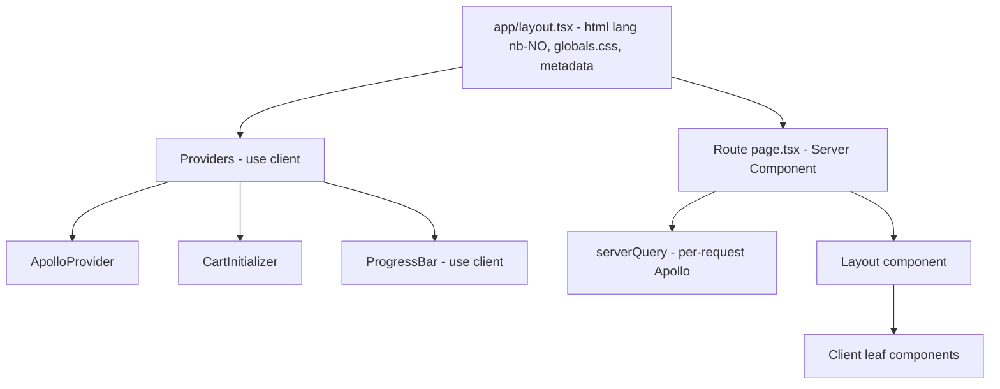

# Pages Router → App Router migration plan

## Current state

- Next `16.4.2`, React `19.3.1`. **No version upgrade needed.**
- Routes in [`src/pages`](../src/pages):

| Route | File | Data | Notes |
|---|---|---|---|
| `/` | [`index.tsx`](../src/pages/index.tsx) | `getStaticProps`, revalidate 60 | Layout title `Hjem` |
| `/produkter` | [`produkter.tsx`](../src/pages/produkter.tsx) | `getStaticProps`, revalidate 60 | Overrides title with `next/head` |
| `/kategorier` | [`kategorier.tsx`](../src/pages/kategorier.tsx) | `getStaticProps`, revalidate 10 | |
| `/produkt/[slug]` | [`produkt/[slug].tsx`](../src/pages/produkt/[slug].tsx) | `getServerSideProps` | 301 redirect when `?id=` is present |
| `/kategori/[slug]` | [`kategori/[slug].tsx`](../src/pages/kategori/[slug].tsx) | `getServerSideProps` | Uses the `?id=` query, not the slug |
| `/handlekurv` | [`handlekurv.tsx`](../src/pages/handlekurv.tsx) | client only | |
| `/kasse` | [`kasse.tsx`](../src/pages/kasse.tsx) | client only | |
| `/logg-inn` | [`logg-inn.tsx`](../src/pages/logg-inn.tsx) | client only | |
| `/min-konto` | [`min-konto.tsx`](../src/pages/min-konto.tsx) | client, `withAuth` HOC | Redirects to `/logg-inn` |

- [`_app.tsx`](../src/pages/_app.tsx) contains `ApolloProvider`, `CartInitializer`, global CSS, and NProgress via `Router.events`.
- [`_document.tsx`](../src/pages/_document.tsx) sets `lang="nb-NO"` and the favicon.

## Migration risks

1. **Apollo singleton on the server.** [`ApolloClient.ts`](../src/utils/apollo/ApolloClient.ts) uses one module-level `InMemoryCache`. Server Components would share it across requests and serve stale data. Server fetches need a **new client for each request** (`src/utils/apollo/serverQuery.ts`).
2. **`next/head`** in [`Header.component.tsx`](../src/components/Header/Header.component.tsx) and `produkter.tsx` does nothing in `app/`. Titles and meta tags must move to `metadata`/`generateMetadata`.
3. **`next/router`** is used in [`withAuth`](../src/components/User/withAuth.component.tsx), [`UserLogin`](../src/components/User/UserLogin.component.tsx) and [`CartContents`](../src/components/Cart/CartContents.component.tsx) (`router.pathname`). These must switch to `next/navigation`.
4. **NProgress** relies on `Router.events`, which App Router doesn't have. It needs a replacement.
5. **The legacy `?id=` 301 redirect** on `/produkt/[slug]`. `permanentRedirect()` sends 308, not 301. `next.config` redirects keep the query string, so the redirect would loop. Use `src/proxy.ts` (Next 16's name for middleware) and return a 301 explicitly.
6. **Async `params`/`searchParams`.** Since Next 15 these are Promises and must be awaited.
7. **Caching defaults.** Apollo uses `fetch`, which Next patches and doesn't cache by default. Each route needs explicit `revalidate` or `dynamic` exports to keep its current ISR or SSR behaviour.
8. **The same route can't exist in both `pages/` and `app/`.** Next fails the build. Delete each `pages` file in the same commit as its `app` replacement.
9. **Client boundaries.** Interactive components (Navbar search, Hamburger, Cart, AddToCart, SingleProduct, Checkout, forms, motion animations) need `'use client'`. This is harmless in `pages/`, so it can be added before the migration.

## Target architecture

## Test-first safety net

These Playwright tests run against the current Pages build first and must pass. They then run unchanged after each migration step.

- Each route returns 200 and shows its key content (the h1 or PageTitle, a product card, category links).
- The exact `<title>` and meta description for each route, captured from the current build.
- `<html lang="nb-NO">` and the favicon link are present.
- `/produkt/<slug>?id=123` returns **301** to `/produkt/<slug>`.
- Category navigation through `?id=` (already covered in `Categories.spec.ts`).
- Product page: clicking add to cart increments the header cart count, and `/handlekurv` lists the item.
- `/kasse` renders the billing form.
- `/min-konto` redirects to `/logg-inn` when the user is not logged in.
- An unknown route returns 404.
- `pnpm build` passes (type check and route conflicts).
