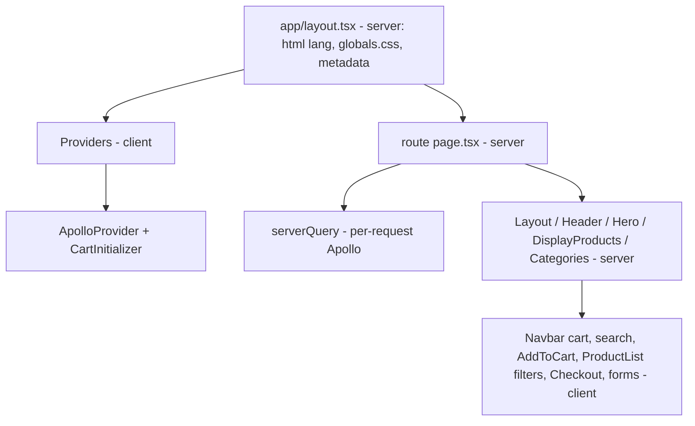

# Pages Router → App Router migration

**Status: done.** `src/pages` has been removed and every route is served from [`src/app`](../src/app).
Next `16.4.2`, React `19.3.1`. No version upgrade was needed.

## Route mapping

| Route | App Router file | Rendering | Notes |
|---|---|---|---|
| `/` | [`app/page.tsx`](../src/app/page.tsx) | ISR, `revalidate = 60` | Absolute title (the layout template does not apply to the same segment) |
| `/produkter` | [`app/produkter/page.tsx`](../src/app/produkter/page.tsx) | ISR, `revalidate = 60` | `title.absolute = 'Produkter \| WooCommerce Next.js'` (as before) |
| `/kategorier` | [`app/kategorier/page.tsx`](../src/app/kategorier/page.tsx) | ISR, `revalidate = 10` | |
| `/produkt/[slug]` | [`app/produkt/[slug]/page.tsx`](../src/app/produkt/[slug]/page.tsx) | `dynamic = 'force-dynamic'` | `generateMetadata`; unknown slug → 404; backend error → error text |
| `/kategori/[slug]` | [`app/kategori/[slug]/page.tsx`](../src/app/kategori/[slug]/page.tsx) | `dynamic = 'force-dynamic'` | Looks up by the `?id=` search param; missing id / unknown category → 404 |
| `/handlekurv` | [`app/handlekurv/page.tsx`](../src/app/handlekurv/page.tsx) | static shell + client cart | |
| `/kasse` | [`app/kasse/page.tsx`](../src/app/kasse/page.tsx) | static shell + client checkout | |
| `/logg-inn` | [`app/logg-inn/page.tsx`](../src/app/logg-inn/page.tsx) | static shell + client form | |
| `/min-konto` | [`app/min-konto/page.tsx`](../src/app/min-konto/page.tsx) | static shell + client `withAuth` | Redirects anonymous users to `/logg-inn` |

## What replaced what

| Pages Router | App Router |
|---|---|
| `_document.tsx` (`lang="nb-NO"`, favicon) | [`app/layout.tsx`](../src/app/layout.tsx) `<html lang>` + `metadata.icons` |
| `_app.tsx` (`ApolloProvider`, `CartInitializer`, global CSS) | [`app/layout.tsx`](../src/app/layout.tsx) + [`app/providers.tsx`](../src/app/providers.tsx) (`'use client'`) |
| NProgress via `Router.events` | [`app/loading.tsx`](../src/app/loading.tsx) (`nprogress` deps removed) |
| `next/head` in `Header` and `produkter.tsx` | `metadata` / `generateMetadata` with a `title.template` in the root layout |
| `getStaticProps` + `revalidate` | async Server Component + `export const revalidate` |
| `getServerSideProps` | async Server Component + `export const dynamic = 'force-dynamic'` |
| Shared browser Apollo client used on the server | [`serverQuery()`](../src/utils/apollo/serverQuery.ts): a new client per call, deduplicated per request with React `cache()` |
| 301 in `getServerSideProps` for `/produkt/:slug?id=` | [`src/proxy.ts`](../src/proxy.ts) (keeps 301; `permanentRedirect()` would send 308) |
| `next/router` (`withAuth`, `UserLogin`, `CartContents`) | `next/navigation` (`useRouter`, `usePathname`) |

## Server/client split

`'use client'` is only on components that use hooks or browser APIs. Pages and the components that wrap them stay Server Components.

## Intentional behaviour changes

- `/kategori/<slug>` without `?id=` and unknown product slugs now return **404** (they used to throw a 500).
- `/produkter` no longer has an unreachable "loading" branch (the old `getStaticProps` always resolved before rendering).
- The top progress bar is replaced by the route-level `loading.tsx` spinner.

## Verification

- `pnpm build` passes with no `pages` routes left.
- Playwright on chromium passes, including tests added before the migration and captured from the Pages build:
  - [`Routes.spec.ts`](../src/tests/Routes/Routes.spec.ts): every route returns 200 and shows its key content.
  - [`Seo.spec.ts`](../src/tests/Seo/Seo.spec.ts): exact titles, description, keywords, og:title, `lang`, favicon.
  - [`Redirects.spec.ts`](../src/tests/Redirects/Redirects.spec.ts): legacy `?id=` → 301, unknown route/product/category → 404, `/min-konto` → `/logg-inn`.
  - [`Cart.spec.ts`](../src/tests/Cart/Cart.spec.ts): add to cart → header count → `/handlekurv` → `/kasse`. Browser GraphQL is mocked because the backend blocks CORS from localhost.
- Firefox/WebKit projects need their browser binaries (`pnpm exec playwright install`), which are not installed on this machine.

## Follow-ups (not part of the migration)

- `"lint": "next lint"` in `package.json`: `next lint` was removed in Next 16; switch to the ESLint CLI.
- Measure client JS / TBT before and after with `pnpm lhci` to quantify the RSC gains.
- Consider pushing client boundaries further down (e.g. inside `SingleProduct`).
- The old `registrer` page backup was moved to [`plans/legacy/registrer.tsx.backup`](legacy/registrer.tsx.backup).
