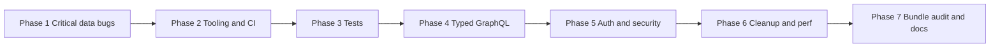

# Senior-quality improvements (Pages Router)

The App Router migration is postponed. This plan fixes correctness, tooling and hygiene on the current Pages Router so the later migration starts from a clean, tested base.

## Phases

## Phase 1 – Critical data bugs

1. **Per-request Apollo client.** Replace the singleton in `src/utils/apollo/ApolloClient.ts` with this pattern:
   - Add a `createApolloClient()` factory.
   - On the server, every `getStaticProps` and `getServerSideProps` call creates a new client with `ssrMode: true` and `fetchPolicy: 'no-cache'`.
   - The browser keeps a memoized client that `_app.tsx` uses.
   - Keep the `middleware` and `afterware` links in the client the browser uses.
2. **Single fetch helper.** Add `src/utils/apollo/serverQuery.ts`. It wraps `client.query` in try/catch and returns typed data or `null` (to log and fall back), so pages never throw on a WordPress outage.
3. **`src/pages/produkt/[slug].tsx`:**
   - Return `{ redirect: { destination, permanent: true } }` instead of writing the response by hand (`res.end`).
   - Return `{ notFound: true }` when there is no product.
   - Drop `loading`, `networkStatus` and `withRouter`.
   - Type it as `NextPage<InferGetServerSidePropsType<...>>`.
   - Fix the `product.name` access that crashes when the product is missing.
   - Add `Cache-Control: public, s-maxage=60, stale-while-revalidate=300`.
4. **`src/pages/kategori/[slug].tsx`:** same treatment as the product page (notFound, error handling, typing, cache header).
5. **`index.tsx`, `produkter.tsx`, `kategorier.tsx`:**
   - Remove the meaningless `loading` and `networkStatus` props.
   - Handle errors so a WordPress outage keeps serving the last cached page instead of crashing.
   - Use correct `NextPage<Props>` generics.
6. Add the pages `src/pages/404.tsx` and `src/pages/500.tsx` (Norwegian text, using `Layout`).

## Phase 2 – Tooling and CI

1. **ESLint 9 flat config.**
   - Add the dev dependencies `eslint`, `eslint-config-next` and `typescript-eslint`.
   - Create `eslint.config.mjs` and delete `.eslintrc.json`.
   - Re-enable `@next/next/no-img-element`.
   - Remove the `JSX` global.
2. **Scripts in `package.json`:**
   - `lint`: `eslint .`
   - `typecheck`: `tsc --noEmit`
   - `format:check`
   - `test:unit`: `vitest run`
   - Make `refresh` cross-platform (use `rimraf`) or delete it.
3. **Dependency hygiene:**
   - Move `@types/react` to devDependencies and add `@types/react-dom`.
   - Move `autoprefixer` and `postcss` to devDependencies.
   - Remove `babel-plugin-styled-components`.
   - Check that `uuid` is still used.
4. **tsconfig:** turn on `noUncheckedIndexedAccess`, `noImplicitOverride` and `noFallthroughCasesInSwitch`. Turn off `allowJs` if there are no JS files.
5. **CI:** add `.github/workflows/ci.yml` (pinned actions, `permissions: contents: read`, `concurrency` cancel-in-progress) that runs `typecheck`, `lint`, `format:check` and `test:unit` on PRs. The `build` step stays in `playwright.yml`.
6. **`.env.example`:** document every `NEXT_PUBLIC_*` variable, including Algolia. Validate env at startup with a small `src/utils/env.ts` (zod).

## Phase 3 – Tests

1. Set up Vitest and React Testing Library (jsdom), configured in `vitest.config.ts`. Unit tests go in `src/**/*.test.ts(x)`, and Playwright is restricted to `*.spec.ts`.
2. Unit-test the pure logic:
   - `utils/functions/price.ts`
   - `utils/functions/productUtils.ts`
   - `utils/functions/functions.tsx` (the cart/checkout data mapping)
   - `hooks/useProductFilters.ts`
   - `stores/cartStore.ts`
   - `getErrorMessage` in `utils/auth.ts`
   - the session expiry logic in `ApolloClient.ts`
3. Add Playwright E2E specs:
   - The product page renders, and the old `?id=` URL gives a 301.
   - An unknown product returns 404.
   - The category page lists products.
   - Add to cart, then the cart count updates.
   - `min-konto` redirects to `logg-inn` when logged out.
4. Playwright:
   - Use the `webServer` config instead of the manual start/wait loop in CI.
   - Enable the mobile viewport project.
   - Remove `DEBUG: pw:api` from CI.

## Phase 4 – Typed GraphQL

1. Add `@graphql-codegen/cli` with the `client-preset` (typed `graphql()` documents) and `codegen.ts` pointing at `NEXT_PUBLIC_GRAPHQL_URL`. Commit the generated output so CI doesn't need the endpoint.
2. Move the queries in `GQL_QUERIES.ts` and `GQL_MUTATIONS.ts` to typed documents.
3. Replace the hand-written types in `src/types/graphql.ts` and `product.ts`, and the interfaces inside components, with the generated ones. Delete the 22 unused types listed in `TODO.md`.

## Phase 5 – Auth and security

1. **`src/utils/auth.ts`:**
   - Use the shared browser client for `login()` instead of creating a new `ApolloClient` per call.
   - Implement `logout` (a WPGraphQL logout mutation, then clear the cart and session) or delete the commented-out block.
2. **`withAuth`:**
   - Remove the redundant `isChecking` state and use `router.replace`.
   - Document that the cookie lives on the WP domain, so the check can't happen on the server until requests to WordPress go through the Next.js domain (a proxy route).
3. **Security headers in `next.config.ts` via `headers()`:**
   - `Strict-Transport-Security`, `X-Content-Type-Options`, `Referrer-Policy`, `Permissions-Policy`, `X-Frame-Options`.
   - A CSP in report-only mode, allowing GraphQL, Algolia and Cloudinary.
   - Also set `poweredByHeader: false`.
4. Remove the `via.placeholder.com` remote pattern if it's unused, and tighten the `pathname` patterns.

## Phase 6 – Cleanup and performance

1. Delete the dead files and exports:
   - `src/pages/registrer.tsx.backup`, `TODO/`, the empty `state/`, `src/images/hero.jpg` (duplicate)
   - `src/styles/algolia.min.css` and `animate.min.css` if they are unused
   - the unused exports listed in `TODO.md`
2. Replace `` with `next/image` in `SearchResults`, `SingleProduct` and `DisplayProducts`. Add `sizes` to `Hero`.
3. NProgress: register the `Router.events` listeners inside a `useEffect` in `_app.tsx` (with cleanup) instead of at module scope.
4. Add an SEO baseline:
   - Per-page `<meta description>`, canonical URL and Open Graph tags in `Layout`.
   - Product JSON-LD.
   - `public/robots.txt`, and a sitemap generated via `getServerSideProps` (`pages/sitemap.xml.ts`).
5. Run `pnpm doctor` and update `TODO.md` or replace it with GitHub issues.

## Phase 7 – Bundle audit and docs

1. Run the `next-bundle-optimizer` skill in **audit mode**: `next analyze --output`, then export. Record the results in `DOCS/bundle-audit.md` (Algolia, motion and Apollo are the likely targets).
2. README:
   - Architecture section with a diagram.
   - Updated scripts.
   - Quality gates and badges.
   - A "Future: App Router migration" note linking the earlier assessment.
3. Add `CODEOWNERS` and a PR template with a checklist.

## Out of scope

- The App Router migration and the four Cache Components and Partial Prefetching skills.
- Tailwind 4 upgrade (separate plan).
